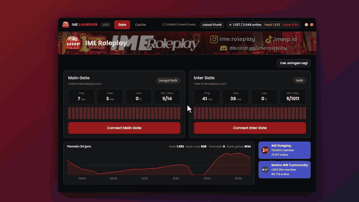
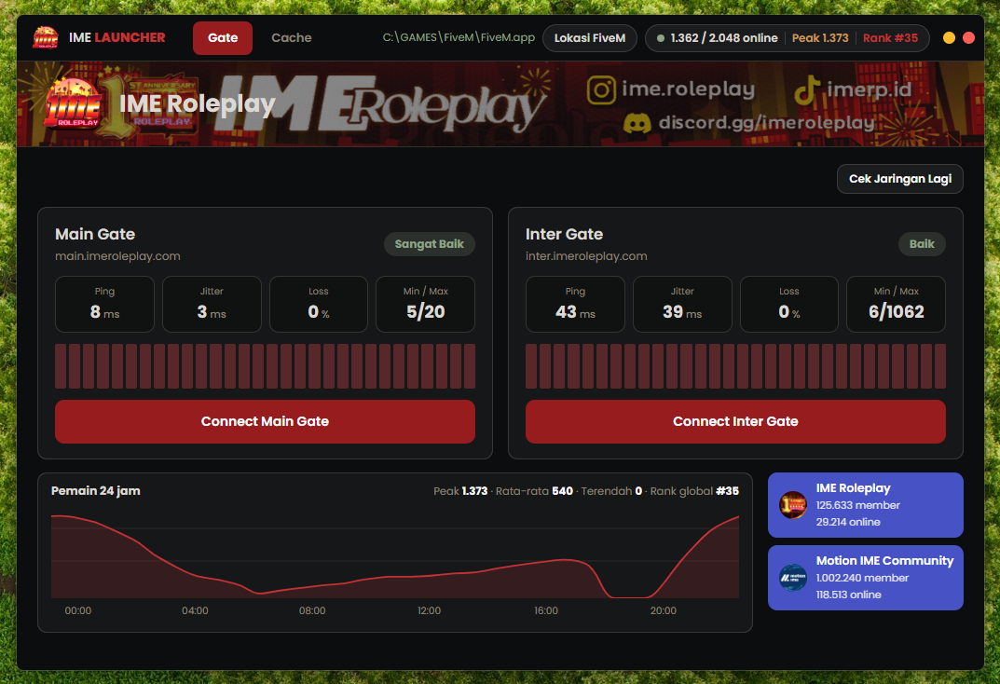
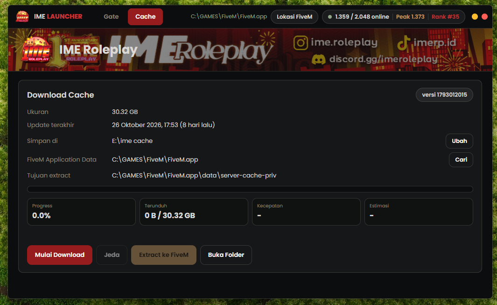

# IME Launcher

## Download di sini

### [Download IMELauncher.exe (versi terbaru)](https://github.com/irhagram/IME-Launcher/releases/latest/download/IMELauncher.exe)

Windows 10 atau 11 (64-bit). Tidak perlu instalasi: setelah terunduh, langsung jalankan. Catatan perubahan ada di halaman [Releases](https://github.com/irhagram/IME-Launcher/releases/latest).

## Video tutorial

Cara memakai launcher dari awal sampai connect.



Versi dengan suara dan kontrol putar: [tonton video lengkap](https://github.com/irhagram/IME-Launcher/blob/main/docs/ime-launcher-tutorial-small.mp4).

---

Launcher Windows untuk server **iME Roleplay**. Dipakai untuk memilih gerbang (Main / Inter), cek jaringan, connect ke server, dan mengunduh cache.



## Persyaratan

- Windows 10 atau 11 (64-bit)
- FiveM sudah terpasang
- [WebView2 Runtime](https://developer.microsoft.com/microsoft-edge/webview2/) (sudah bawaan Windows 11 dan sebagian besar Windows 10)
- Ruang disk kosong lebih dari 30 GB untuk cache

## Memulai

1. [Unduh `IMELauncher.exe`](https://github.com/irhagram/IME-Launcher/releases/latest/download/IMELauncher.exe) (versi terbaru).
2. Jalankan. Tidak perlu instalasi, file boleh ditaruh di folder mana saja.
   Kalau muncul peringatan Windows SmartScreen: klik **More info**, lalu **Run anyway**.
3. Atur lokasi FiveM (lihat bagian berikut).
4. Pilih gerbang dan klik **Connect**.

## Mengatur lokasi FiveM

Launcher perlu tahu di mana **FiveM Application Data** berada, yaitu folder `FiveM.app`.

1. Lihat di bagian atas, sebelah kiri tombol **Lokasi FiveM**.
   - Teks hijau berisi path (contoh `C:\GAMES\FiveM\FiveM.app`): sudah benar, tidak perlu apa-apa.
   - Teks emas **FiveM: belum diatur**: lokasi belum ditemukan.
2. Klik **Lokasi FiveM**, lalu pilih folder `FiveM.app`.
   - Boleh juga memilih folder `FiveM` di atasnya; launcher mencari `FiveM.app` sendiri.
   - Folder yang dipilih harus punya subfolder `data`.
3. Cara menemukan foldernya:
   - Klik kanan shortcut FiveM, lalu **Open file location**. Folder yang terbuka berisi `FiveM.exe` dan folder `FiveM.app`.
   - Atau tempel `%LocalAppData%\FiveM` di address bar Explorer (lokasi bawaan jika FiveM dipasang di drive C).

Lokasi yang tersimpan tetap dipakai pada pembukaan berikutnya.

## Connect ke server

1. Buka tab **Gate**. Cek jaringan berjalan otomatis (Main dulu, lalu Inter).
2. Klik **Connect Main Gate** atau **Connect Inter Gate**.
   - **Main**: gerbang utama.
   - **Inter**: gerbang internasional.
3. Sebelum membuka FiveM, launcher memastikan `CitizenFX.ini` di FiveM Application Data berisi pengaturan iME (`PoolSizesIncrease`, `DefaultBuild`, `SavedBuildNumber`). Baris lain tidak diubah, dan salinan asli disimpan sebagai `CitizenFX.ini.imebak`.
4. FiveM terbuka dan langsung connect ke gerbang yang dipilih.

Kalau FiveM sedang terbuka saat pengaturan baru diterapkan, launcher menampilkan pesan agar kamu **menutup FiveM sepenuhnya** lalu klik Connect lagi. Pengaturan hanya terbaca saat FiveM dimulai.

## Membaca halaman Gate

**Header**

| Bagian | Isi |
|---|---|
| Path hijau + **Lokasi FiveM** | Lokasi FiveM Application Data yang tersimpan, dan tombol untuk menggantinya |
| `1.359 / 2.048 online` | Jumlah pemain online dan kapasitas server |
| **Peak** | Jumlah pemain tertinggi dalam 24 jam terakhir |
| **Rank** | Peringkat server di daftar server global (data 5metrics) |
| Titik kuning / merah | Minimize / tutup |

**Kartu gerbang (Main dan Inter)**

| Angka | Arti |
|---|---|
| Ping | Rata-rata waktu sambung dari PC kamu ke gerbang |
| Jitter | Seberapa tidak stabil ping dari satu ukuran ke ukuran berikutnya |
| Loss | Persentase paket UDP yang tidak dibalas (jalur yang dipakai game) |
| Min / Max | Ping terendah dan tertinggi saat pengukuran |

Pengukuran dilakukan 30 kali, satu kali per detik, dan angkanya berubah langsung selama proses. Batang di bawah angka menunjukkan tiap ukuran; batang merah penuh berarti paket UDP pada ukuran itu tidak dibalas.

| Rating | Syarat |
|---|---|
| Sangat Baik | ping di bawah 30 ms dan loss maksimal 2% |
| Baik | ping 30 ms ke atas atau loss di atas 2% |
| Sedang | ping 80 ms ke atas atau loss di atas 6% |
| Buruk | ping 150 ms ke atas atau loss di atas 15% |

Klik **Cek Jaringan Lagi** untuk mengukur ulang.

> Angka ini dihitung dari PC kamu ke gerbang. Ping yang tampil di dalam game bisa berbeda, karena ikut dipengaruhi beban server.

**Grafik pemain 24 jam**: arahkan mouse ke grafik untuk melihat jam dan jumlah pemain. Di atasnya ada ringkasan peak, rata-rata, terendah, dan rank global.

**Tombol Discord**: IME Roleplay dan Motion IME Community, lengkap dengan jumlah member dan online.

## Download cache



Cache mempercepat loading dan mencegah texture loss. Ukurannya sekitar 30 GB.

1. Buka tab **Cache**. Di bagian atas terlihat versi cache, ukuran, dan tanggal **Update terakhir**.
2. **Simpan di**: folder tempat file diunduh. Klik **Ubah** untuk memilih drive lain (bawaan: `Downloads\IMECache`). Pastikan ruang disk cukup.
3. **FiveM Application Data**: harus terisi. Kalau kosong, klik **Cari** dan pilih folder `FiveM.app`.
4. Klik **Mulai Download**. Terlihat progress, jumlah terunduh, kecepatan, dan estimasi waktu.
5. **Jeda** menghentikan sementara. Klik **Lanjutkan** untuk meneruskan dari bagian yang sudah terunduh. Hal yang sama berlaku kalau koneksi terputus atau launcher ditutup.
6. Setelah mencapai 100%, klik **Extract ke FiveM**. Launcher mengunduh `ImeCache.exe` resmi ke folder yang sama dan menjalankannya. Ikuti langkah installer sampai selesai; hasilnya masuk ke `FiveM.app\data\server-cache-priv` (tertulis di baris **Tujuan extract**).
7. Setelah selesai, `ImeCache.exe` dan `ImeCache-1.bin` boleh dihapus untuk melegakan ruang disk. Tombol **Buka Folder** membuka folder penyimpanannya.

Kalau versi cache baru dirilis, launcher mengunduh versi baru dari awal dan tidak memakai file lama.

## Update dan status launcher

Saat dibuka (dan tiap 10 menit), launcher membaca [`launcher.json`](launcher.json) dari branch `main` repo ini. Dari situ admin bisa mengatur apakah launcher boleh dipakai.

```json
{
  "launcher": {
    "enabled": true,
    "minimum_version": "1.0.0",
    "latest_version": "1.0.0",
    "force_update": false,
    "maintenance": false,
    "download_url": "https://github.com/irhagram/IME-Launcher/releases/latest/download/IMELauncher.exe",
    "sha256": "",
    "message": ""
  }
}
```

| Kolom | Fungsi |
|---|---|
| `enabled` | `false` mengunci launcher untuk semua versi ("Launcher Dinonaktifkan") |
| `maintenance` | `true` mengunci launcher dengan layar maintenance |
| `minimum_version` | Versi di bawah ini langsung terkunci dan wajib update |
| `latest_version` | Versi terbaru. Versi di bawahnya tidak dikunci dan tidak ada popup: hanya muncul tag **NEW** merah di samping nomor versi. Klik tag itu untuk membuka popup berisi detail update (diambil dari catatan release di GitHub), lalu pilih **Update Sekarang** atau **Tutup** |
| `force_update` | `true` membuat semua versi di bawah `latest_version` wajib update, sama seperti di bawah `minimum_version` |
| `download_url` | Sumber update. Link langsung ke exe (`.../releases/latest/download/IMELauncher.exe`) bisa diunduh langsung oleh launcher. Hanya link `https://github.com/...` yang diterima |
| `sha256` | Hash SHA-256 `IMELauncher.exe` yang dirilis (64 karakter hex). Kalau terisi, launcher mengunduh dan memasang update sendiri; kalau kosong, tombolnya membuka `download_url` di browser |
| `message` | Pesan yang tampil di layar. Kosong berarti memakai teks bawaan |

**Update otomatis.** Popup layar penuh hanya dipakai untuk update wajib (dan maintenance atau dinonaktifkan). Update biasa hanya memunculkan tag **NEW** di samping versi; kalau diklik, popup detail update muncul dan bisa ditutup. Untuk update wajib, popup muncul sendiri, launcher terkunci, dan satu-satunya tombol adalah **Update Sekarang**. Detail update selalu diambil dari release dengan tag yang sama dengan `latest_version` (misalnya `1.0.3`), jadi isi catatan release di GitHub itulah yang dibaca pemain. Syaratnya `sha256` terisi. Launcher mengunduh exe baru di latar belakang, mencocokkan hash-nya dengan `sha256`, mengganti dirinya, lalu terbuka ulang sendiri. Kalau hash tidak cocok, unduhan gagal, atau folder launcher tidak bisa ditulis, exe lama tidak diubah. Di update wajib muncul tombol **Download Manual**, di update biasa popup tetap terbuka dengan tombol yang sama. Fitur ini baru ada mulai v1.0.3; versi di bawahnya tetap harus mengunduh manual.

Urutan prioritas: `enabled` lalu `maintenance` lalu update wajib lalu update biasa.

Selama terkunci, semua fitur (connect, cek jaringan, cache, dan lainnya) berhenti, termasuk download yang sedang berjalan. Versi launcher yang sedang dipakai ada di dalam exe (`Version` di `status.go`) dan tampil di header. Kalau JSON tidak bisa dibaca (offline atau file tidak ada), launcher tetap terkunci sampai pemeriksaan berhasil.

Contoh urgent update: ubah `latest_version` ke versi baru, isi `sha256` dengan hash exe barunya, dan ubah `force_update` ke `true`, lalu commit ke `main`. Perubahan terbaca dalam hitungan menit. Isi `sha256` baru setelah release terbit dan exe di release sama persis dengan yang di-hash.

Naik versi: ubah `Version` di `status.go` dan versi di `winres/winres.json`, lalu build ulang.

## Pengaturan lanjutan

Konfigurasi tersimpan di `%AppData%\IMELauncher\config.json`. Isinya bisa diubah dengan Notepad saat launcher ditutup:

| Kolom | Fungsi |
|---|---|
| `gates` | Daftar gerbang (id, nama, host, port) |
| `discords` | Daftar tombol Discord (nama dan link invite) |
| `fivemSettings` | Pengaturan yang ditulis ke `CitizenFX.ini` sebelum connect |
| `metricsId` | ID server di 5metrics.dev |
| `cacheUrl` | Halaman CDN yang memuat versi cache |
| `downloadDir`, `fivemDir` | Lokasi yang tersimpan |

Hapus file ini untuk mengembalikan semuanya ke bawaan.

## Masalah umum

| Masalah | Solusi |
|---|---|
| Connect menolak dan meminta lokasi FiveM | Klik **Lokasi FiveM** dan pilih folder `FiveM.app` |
| "folder tidak valid" saat memilih lokasi | Pilih folder yang berisi subfolder `data`, yaitu `FiveM.app` |
| Pesan agar menutup FiveM | Tutup FiveM sepenuhnya (cek Task Manager), lalu Connect lagi |
| Download berhenti di tengah | Klik **Lanjutkan**; file yang sudah terunduh tidak diulang |
| "ruang disk kurang" | Klik **Ubah** dan pilih drive dengan ruang lebih besar |
| Grafik, peak, atau rank kosong | Data diambil dari 5metrics.dev; coba lagi beberapa menit lagi |
| Ping launcher berbeda dengan ping di game | Normal, lihat catatan di bagian Gate |
| Antivirus menandai exe | Launcher belum memakai tanda tangan digital, jadi beberapa antivirus bisa memberi peringatan palsu. Kode sumbernya terbuka di repo ini |

## Build dari source

Butuh Go 1.26 atau lebih baru. Tidak perlu CGO.

```bash
go build -trimpath -tags desktop,production -ldflags "-H windowsgui" -o IMELauncher.exe .
```

Ikon dan info versi ada di `winres/` (hasilnya `rsrc_windows_amd64.syso`), dan frontend (HTML/CSS/JS) di `frontend/` ikut tertanam ke exe.

## Lisensi

Lihat [LICENSE](LICENSE).
